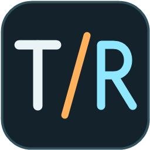
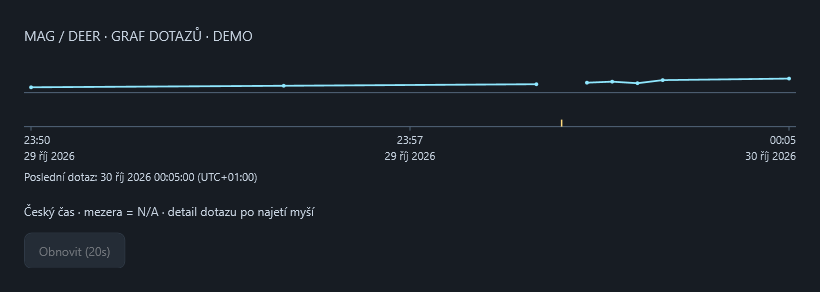

# MAG DEER Server Monitor



A small Windows app for keeping an eye on a DayZ server while you play. Leave it on a second screen to see the player count, the last successful reply and how long is left until the next planned restart.

It started with MAG DEER, but you can select another server or save your own. The included list has five responding MAG DayZ endpoints and all twelve Sunnyvale DayZ servers checked on 29 October 2026.

[Česky](README.cs.md) · [Download the Windows build](../../releases/latest) · [MIT license](LICENSE)

## Get it running

Download `MAG-DEER-Server-Monitor-1.6.0-win-x64.zip` from Releases, unpack it into a folder you can write to, then run `MagDeerMonitor.exe`. It works on Windows 10/11 x64. No separate .NET installation, account, API key or administrator access is needed.

Settings are saved beside the EXE in `config.json`. History is kept in `data`. When updating, close the old copy and keep those two items. For a separate data folder, use:

```powershell
.\MagDeerMonitor.exe --data-dir "D:\MAG Monitor Data"
```

The app unpacks its bundled native runtime into the user's temporary folder on first launch. If you enable startup with Windows, keep the EXE in a stable location.

## What you see

- Large Prague clock, optional world clocks with your own city labels, and 12/24-hour formats.
- Restart countdown with configurable logout and kick reminders, optional sounds and Windows notifications.
- Server reply status, player count and UDP query round-trip time.
- A player graph with date/time labels and exact query details when you hover over a sample. A missing reply leaves a gap.
- Light, dark, orange and gray/green themes, compact/fullscreen views, optional always-on-top, and saved monitor/window placement.

English is the default language. Czech, Polish, German and Spanish are available in **Settings → Display**. The theme selector is at the top of that tab.



## How it checks a server

The app sends A2S_INFO directly to the server's UDP query port. It handles the challenge exchange and measures that exchange's round-trip time. This is UDP query RTT, rather than an ICMP ping. Only the selected server is queried.

By default it checks every five minutes, every thirty seconds in the last fifteen minutes before a planned restart, and every fifteen seconds during the restart window. **Refresh** has a twenty-second countdown to prevent repeated manual requests. Automatic monitoring keeps its own schedule.

A missing UDP reply does not prove the game server is down: the query service could be unavailable or filtered. One timeout never switches the app to OFFLINE, and failed measurements show N/A. Repeated failures produce QUERY UNAVAILABLE; OFFLINE requires manual confirmation in settings. A detected recovery records when query replies resumed.

## Restart times need checking

The default example is 03:00, 07:00, 11:00, 15:00, 19:00 and 23:00 in **Europe/Prague**. Daylight saving time is handled by the time zone. Set the real schedule for your server and confirm it when you have checked it. Included server presets have **unconfirmed** schedules; a successful query does not confirm a restart plan.

The optional offset clock is calculated from Prague time. It does not read DayZ's in-game clock or chat. Optional NTP corrects the time inside this app and leaves Windows time settings alone. See [NTP](docs/NTP.md) and [languages/world clocks](docs/LANGUAGES-AND-CLOCKS.md).

## Build it

Install the .NET 8 SDK on Windows, then run:

```powershell
.\build.ps1
```

The script builds the Visual Studio solution, runs the console and WPF checks, and creates a self-contained single-file Windows x64 build plus source ZIP in `artifacts`. It never launches the desktop app. The WPF checks render controls into PNG files without opening windows.

To work in Visual Studio 2022, open `MagDeerMonitor.sln` with the .NET desktop development workload installed. No external NuGet package is needed beyond Microsoft's runtime/build packs. See [validation](docs/VALIDATION.md) for what has and has not been checked.

## Stream Deck

Integration is possible, but a Stream Deck plugin is not included in this release. Useful actions would be a refresh key with the same twenty-second limit and keys showing players or time until restart. These should use the monitor's existing data so each key does not query the server separately.

## How it was made

This is a hobby project built with AI-assisted **vibe coding**. The idea and requirements grew out of playing DayZ, with AI helping to write and refine the code along the way. Features were added in small steps, with the checks and remaining gaps recorded in [validation](docs/VALIDATION.md). Bug reports and practical suggestions are welcome.

## License

The source and T/R icon use the [MIT license](LICENSE). Bundled runtime notices are included separately in [third-party notices](THIRD_PARTY_NOTICES.md). This is an independent community project, with no official affiliation to MAG, Sunnyvale or the game publishers.
