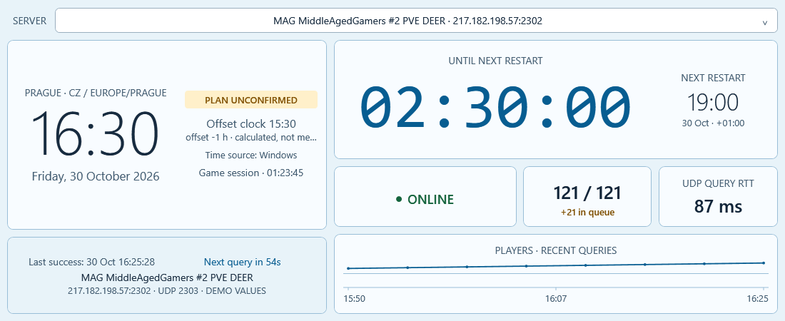
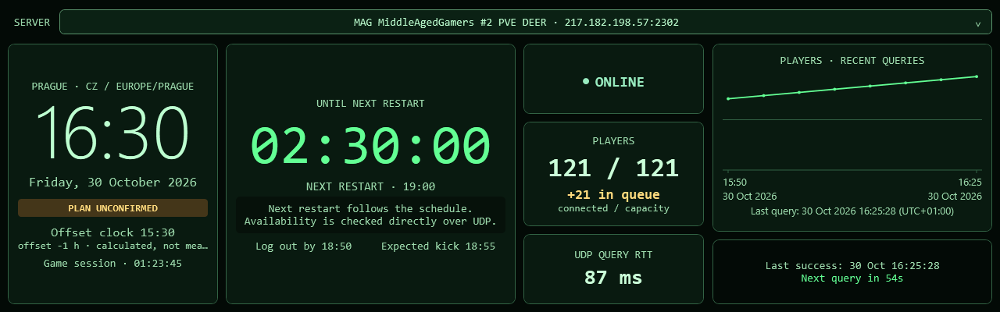

# Display layouts, LCD presets and window controls

The dashboard rearranges the same live controls as the window changes shape. Widening a short window moves the countdown, metrics and graph to the right of the clock. A tall, narrow window stacks them vertically. Resizing keeps the player samples, queue, countdown and query cooldown; it does not send an extra server query.

The title bar is **32 device-independent pixels** high, rather than the old 58. At Windows 150% scaling this is 48 physical pixels. Refresh, settings and the more menu share the title bar. There is no bottom button strip.

Use **⋯ → Display size preset** or **Settings → Appearance**. There are 27 choices: Auto, Desktop, twelve landscape/portrait pairs and Square. A preset resizes the window in physical pixels, subject to Windows DPI and the current monitor's available area. It does not change Windows resolution, rotation or scaling. Manual resizing remains adaptive after selecting a preset. Auto keeps the current window size. The last actual position and size are saved.

**F11** fills the current monitor and hides the title bar; **Esc** leaves fullscreen. Below 260 logical pixels wide the title bar also hides automatically. Right-click anywhere on the dashboard, or use **Shift+F10**, to open the same controls. **F5** requests a refresh with the shared twenty-second limit. **Ctrl+,** opens settings. On a tiny secondary LCD, settings use a larger connected screen if available.

## Sizes found in manufacturer documentation

These are representative products and usable design targets, not market-share measurements or hardware tested with this app. Check the exact model and its native pixels; the diagonal alone does not determine the layout. Landscape and portrait numbers below are the same panel rotated in Windows.

| Family / example | Native pixels or landscape equivalent | Portrait equivalent | Physical reference and use |
|---|---|---|---|
| [Waveshare 3.5″ HDMI](https://www.waveshare.com/wiki/3.5inch_HDMI_LCD) | 480 × 320 | 320 × 480 | Small case window; prioritize time, restart, slots and status |
| [Waveshare 5″ HDMI H](https://www.waveshare.com/5inch-HDMI-LCD-H.htm) | 800 × 480 | 480 × 800 | Compact external/case dashboard |
| [Waveshare 7″ HDMI H](https://files.waveshare.com/upload/5/58/7inch_HDMI_LCD_%28H%29_User_Manual.pdf) | 1024 × 600 | 600 × 1024 | Small general-purpose secondary monitor; native pixels differ from accepted input signals |
| [Waveshare 7.9″ Touch Monitor](https://docs.waveshare.net/7.9inch_Touch_Monitor/) | 1280 × 400 | 400 × 1280 | Manufacturer: enclosure 211 × 73 × 20 mm; display area about 191 × 60 mm |
| [Waveshare 8.8″ Side Monitor](https://www.waveshare.com/wiki/8.8inch_Side_Monitor) | 1920 × 480 | 480 × 1920 | Long case/under-monitor strip; HDMI video and separate USB power |
| [Waveshare 11.9″ Touch Monitor](https://www.waveshare.com/wiki/11.9inch_Touch_Monitor) | 1480 × 320 | 320 × 1480 | Manufacturer: enclosure 290.5 × 73 × 21.5 mm; very shallow bar |
| [Thermaltake 3.9″ LCD kit](https://thermaltake.com/products/3-9-lcd-screen-kit) | 480 × 128 content, depending on orientation | 128 × 480 | Controlled by TT RGB Plus over USB; this is **not** evidence of a Windows desktop display |

The 11.9″ source contains a copied 400 × 1280 sentence in its PC instructions; its product overview, parameters and video timing specify 320 × 1480. The preset uses the latter. These physical dimensions are manufacturer claims, not our measurements.

The other presets are generic window sizes: 1280 × 800, 1366 × 768, 1920 × 1080, 1920 × 1200, 2560 × 1440, their rotated versions, and 720 × 720. They are useful for ordinary second monitors as well as custom enclosures. “Micro ribbon” is a layout target, not a claim of Thermaltake compatibility.

## Connection matters

The WPF app works on a display that **Windows recognizes as an extended desktop monitor**: HDMI/DisplayPort, USB-C carrying video, or a USB display adapter with an appropriate Windows display driver. USB can mean power, touch, video, or a proprietary command channel; a connector does not establish compatibility.

USB-only sensor panels that accept JPG/GIF or vendor commands need a separate device integration. This release does not implement those vendor protocols. Raspberry Pi DSI/SPI panels likewise do not become PC monitors just because their pixel dimensions match a preset. AIDA64 is not needed for supported Windows desktop displays.

## Responsive modes

| Window shape | Arrangement |
|---|---|
| Ordinary tall desktop | Large clock, countdown, metric row, history, details |
| Short / wide | Clock and details left; countdown, metrics and graph right |
| Very wide bar | Clock, countdown, metric column and graph across the screen |
| Portrait | Clock and countdown above status, player slots, RTT and history |
| Small 480 × 320 class | Five essential tiles; graph/details return when more room is available |
| Shallow ribbon | Clock, restart, players, status and RTT; small decorative text is reduced |

In the smallest modes, secondary details, world clocks or the graph may be hidden to keep the essential numbers readable. Data collection continues. Compact mode hides the graph and detailed address block explicitly. A preset cannot create extra physical pixels; inspect the actual LCD before relying on small labels at a distance.

These are renders of the actual WPF dashboard at the stated pixel sizes. They omit the operating window frame and use example server values. They are not photos of connected LCDs.

## Themes

Light, Dark, Orange, retro grey/green, Ocean, Luna (XP inspired), Glass (Aero inspired), Sakura (anime pink/violet), Terminal (Matrix green/black), and Violet. All use complete palettes, including inputs and menus, with player-number contrast above 7:1 in automated checks.

Luna and Glass use original light gradients; Glass does not enable desktop blur/transparency. Sakura uses an original palette, without character artwork. Terminal is static rather than animated code rain, to suit continuous low-load display. No Windows, anime, film or third-party artwork is included.

## Closing and remembering settings

Configuration is saved in `config.json` beside the portable executable, or in the folder supplied through `--data-dir`. Theme, language, server profiles, clocks, display preset, close behavior and the last window bounds are retained. Saving settings applies immediately; closing or hiding captures the current bounds too.

By default, **× quits**. Enable **Settings → App behavior → Close button minimizes instead of quitting**, then choose:

- **Windows taskbar:** the existing window minimizes to the taskbar.
- **Notification area:** the window hides and the T/R icon remains beside the clock. Double-click it, or choose Open monitor, to restore. Windows may place the icon inside its overflow menu.

Monitoring, restart alerts and Stream Deck keep running while minimized or hidden. To stop them, choose **Quit monitor** in the dashboard menu or tray menu. Quitting bypasses the minimize option. Windows session termination also bypasses it.

When updating, close the running executable and unpack the new Windows ZIP into the same writable folder. The ZIP contains the EXE and Stream Deck installer, but no private `config.json` or `data` folder, so existing settings/history are preserved. Install the included `.streamDeckPlugin` only when updating the plugin as well.
