# Screenshots and dashboard previews

## App and Stream Deck in use

User captures from 31 October 2026. The restart plan shown here is unconfirmed.

Dashboard with the Fuji background

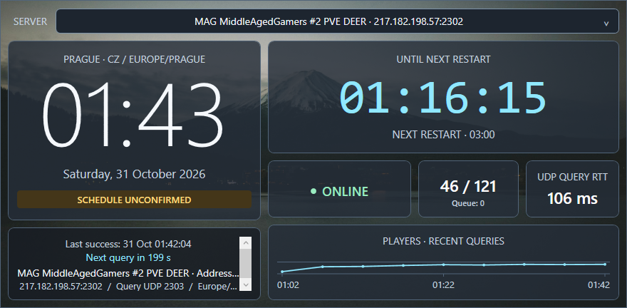

Wide LCD layout

Portrait layout

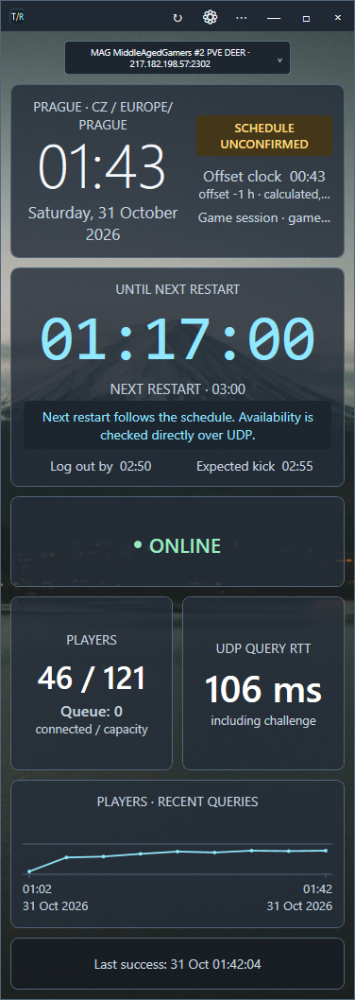

Stream Deck MK.2

[All uploaded captures](images/user-captures).

## Rendered examples

These are renders of the compiled WPF dashboard with English labels and demo data. The palettes and controls are the same ones used by the app. Select them under Settings -> Appearance. Native Windows glass is not captured by the offscreen renderer.

## Palettes

Light

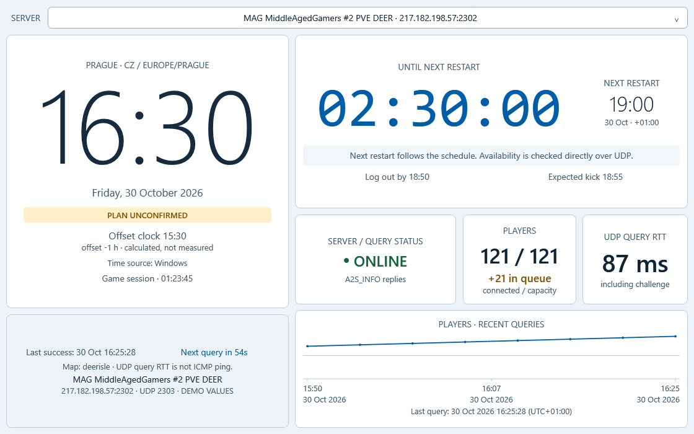

Dark

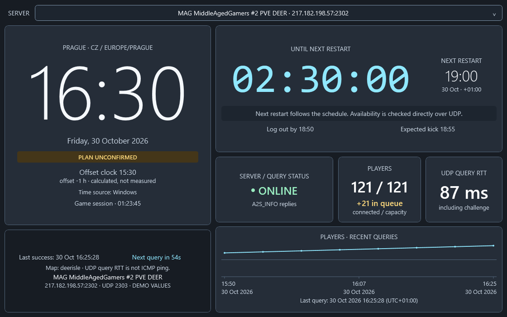

Orange

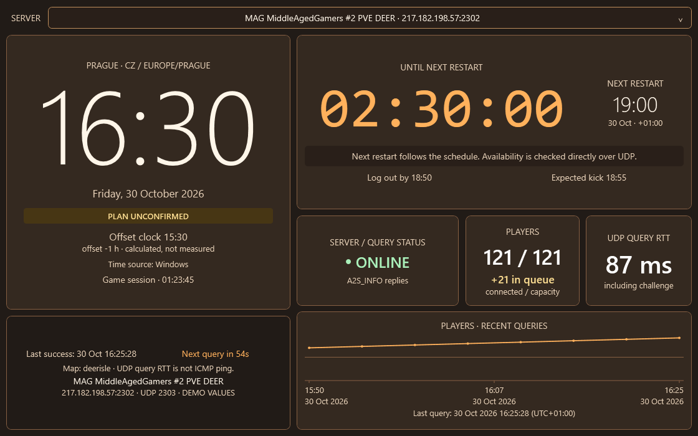

Gray/green retro (config key Spotify)

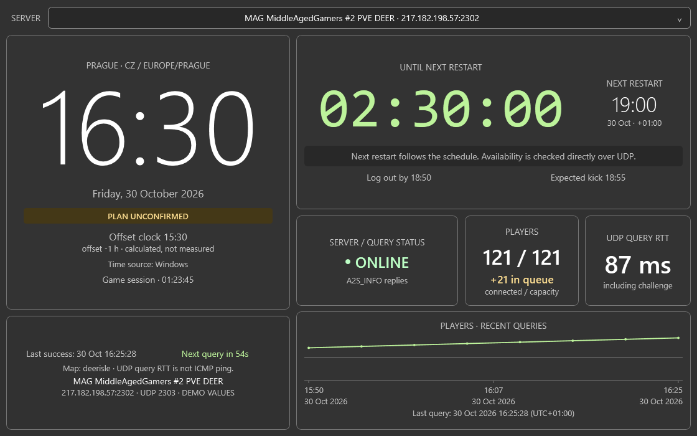

Ocean

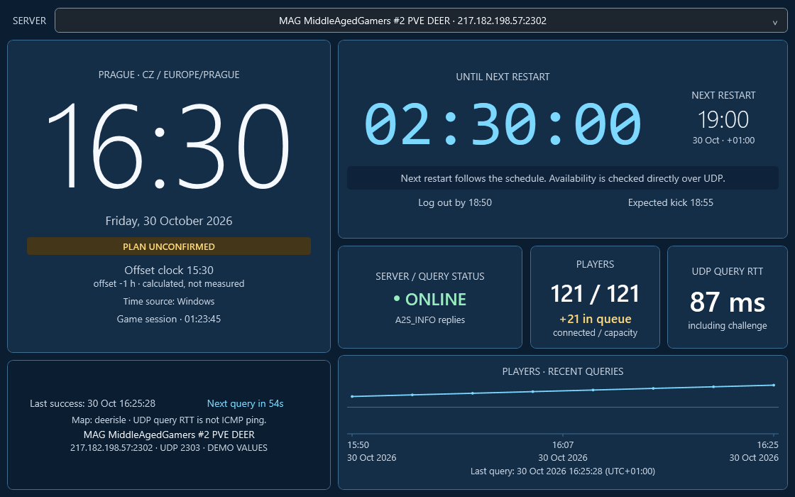

Luna / XP

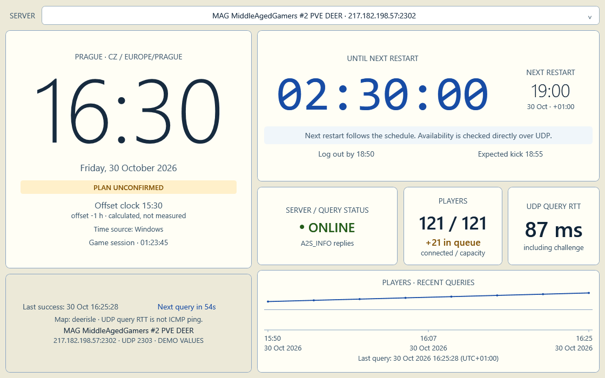

Glass / Aero (palette only here; system transparency depends on Windows)

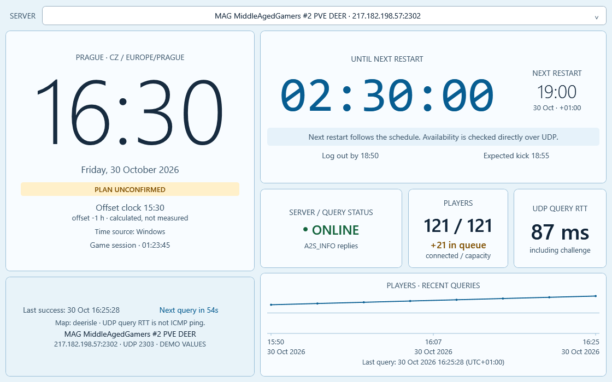

Sakura / Anime with original landscape artwork

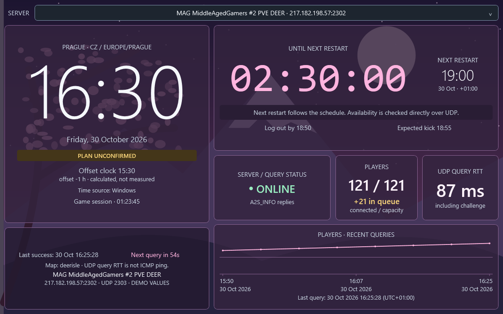

Terminal / Matrix

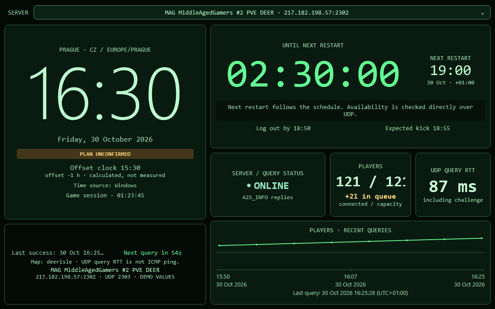

Violet

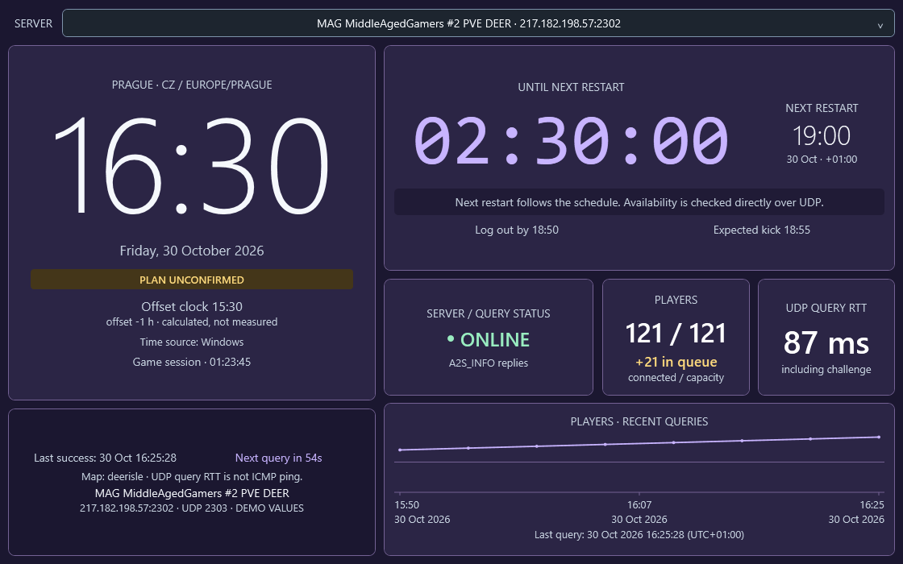

## Photo background

Mount Fuji by Clay Banks, used under the [Unsplash License](licenses/FUJI-PHOTO.md). Cards keep a tint so text remains readable. This photo is separate from the MIT-licensed app artwork.

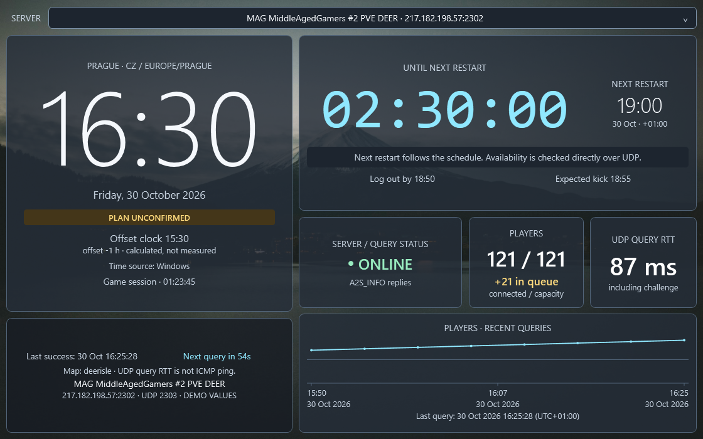

## Countdown colors

Normal, 15 minutes, 10 minutes, 5 minutes, 2:45 and 30 seconds. The last 30 seconds also have a small alternating opacity change on the digits; the rest of the window stays steady. A static PNG cannot show the pulse.

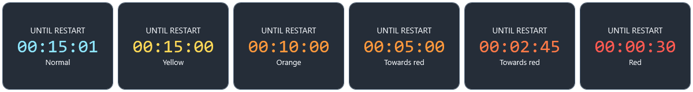

## Layouts

[Large wide window](images/layout-wide-large.png), [desktop](images/layout-desktop.png), [wide](images/layout-wide.png), [1280 x 400 strip](images/layout-bar-79.png), [1920 x 480 strip](images/layout-bar-88.png), [portrait](images/layout-portrait.png), [mini](images/layout-mini.png) and [ribbon](images/layout-ribbon.png).

[Settings](images/settings-overview.png), [restart controls](images/settings-restarts.png), [appearance](images/settings-appearance.png) and [Stream Deck key designs](images/stream-deck-keys.png).
