# Screenshots and dashboard previews

## App and Stream Deck in use

User captures from 31 October 2026. Restart plans shown in these captures are user-configured. A confirmation label reflects manual confirmation in the app.

Dashboard with the Fuji background

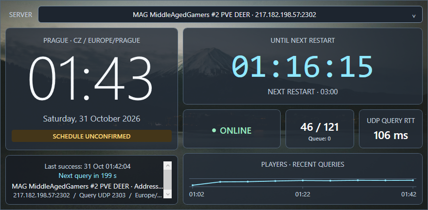

Wide LCD layout

Portrait layout

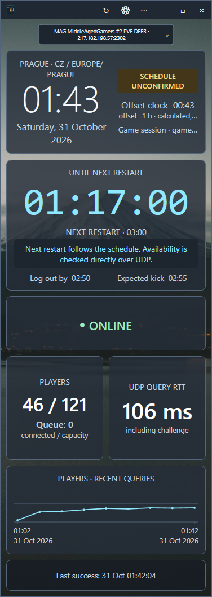

Stream Deck MK.2

Real secondary LCD and Stream Deck setup

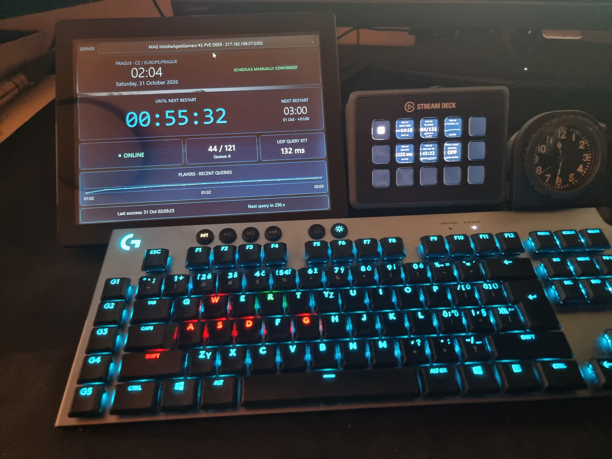

[All uploaded captures](images/user-captures).

## Rendered examples

These are renders of the compiled WPF dashboard with English labels and demo data. The palettes and controls are the same ones used by the app. Select them under Settings -> Appearance. Native Windows glass is not captured by the offscreen renderer.

### MAG Counter-Strike: Source

Current map, occupied slots/capacity, query RTT and local game runtime. This is a rendered example with sample data; the session is Windows game runtime including menus, not a server connection timer. Without a configured and confirmed restart plan, the map takes the main countdown area.

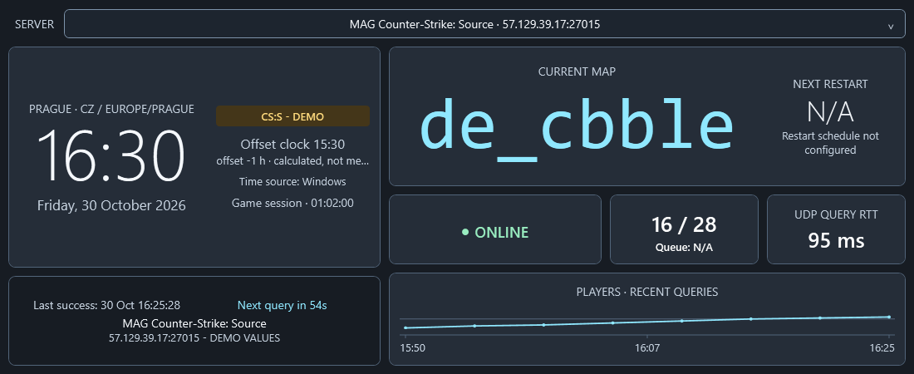

The optional Map view can be pinned to a Stream Deck key or added to a cycle. Existing seven-page cycles remain unchanged.

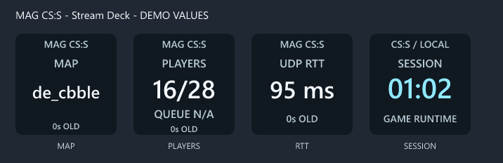

## Palettes

Light

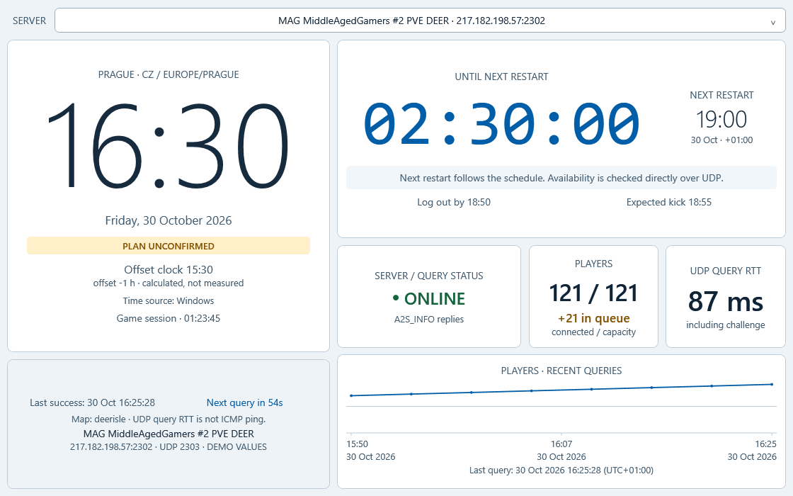

Dark

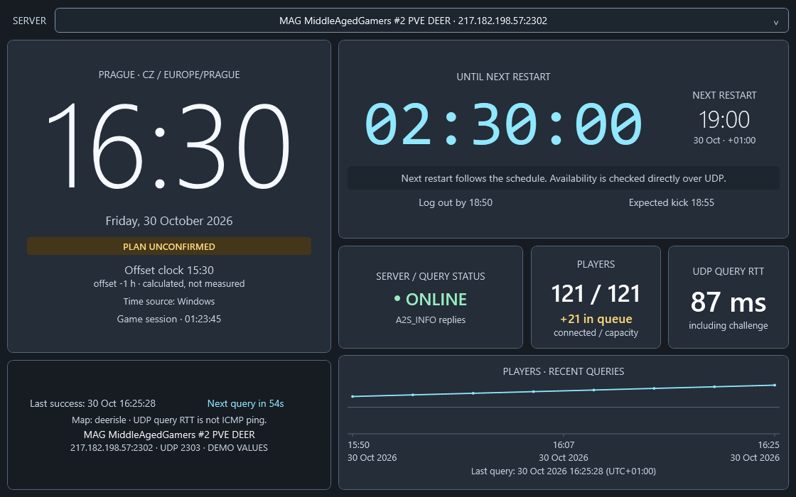

Orange

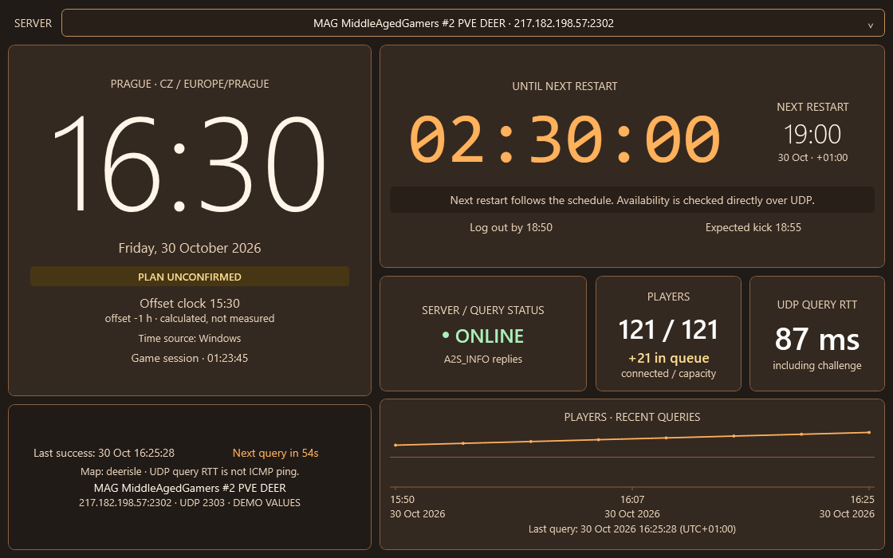

Gray/green retro (config key Spotify)

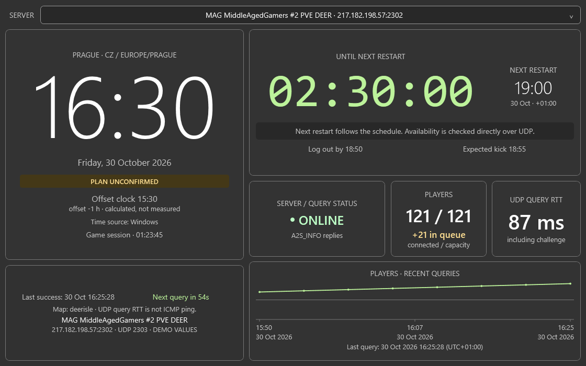

Ocean

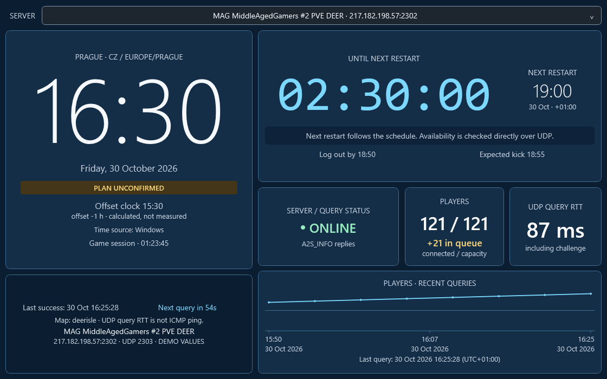

Luna / XP

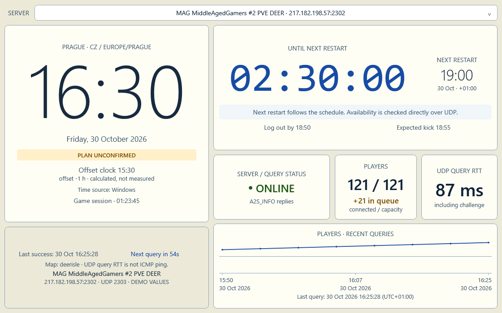

Glass / Aero (palette only here; system transparency depends on Windows)

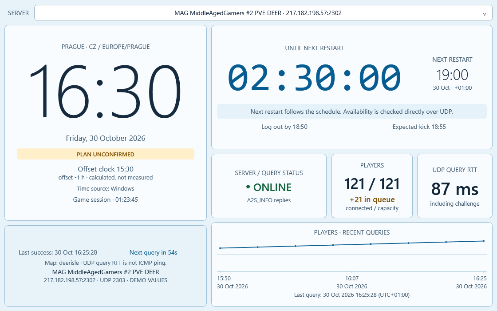

Sakura / Anime with original landscape artwork

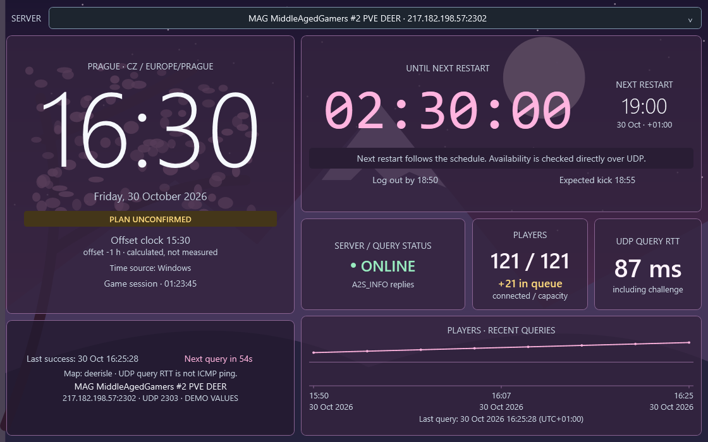

Terminal / Matrix

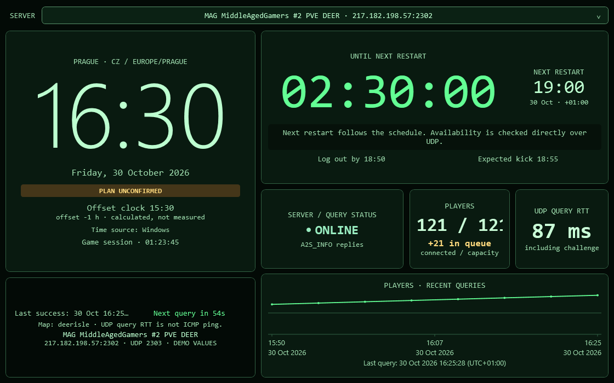

Violet

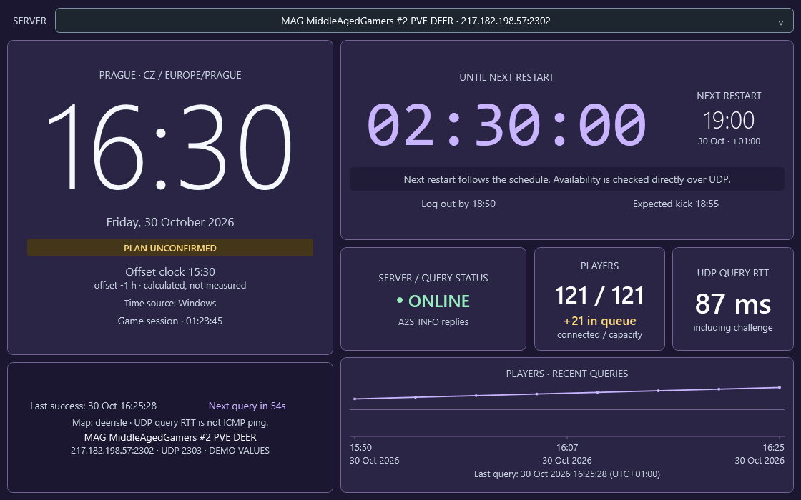

## Photo background

Mount Fuji by Clay Banks, used under the [Unsplash License](licenses/FUJI-PHOTO.md). Cards keep a tint so text remains readable. This photo is separate from the MIT-licensed app artwork.

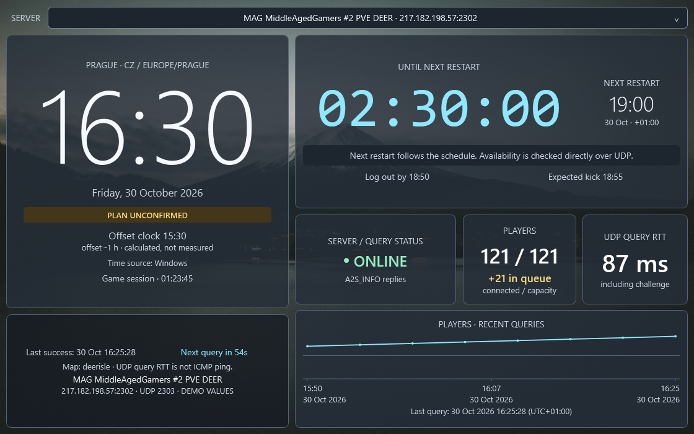

## Countdown colors

### Accelerated animations

These looping demos use the actual WPF dashboard and Stream Deck plugin renderer with simulated data. Each loop takes about 19 seconds: it shows the normal countdown, yellow and orange warnings, the fade to red, the digits-only pulse in the last 30 seconds, steady orange negative time after the planned kick and the countdown to the next kick at the scheduled restart. Timing is accelerated unevenly so the final seconds stay visible. All event times come from a configured schedule, not confirmed server events.

Windows app

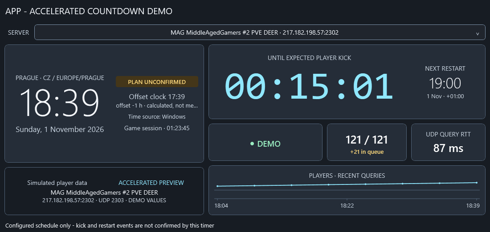

Stream Deck key (enlarged)

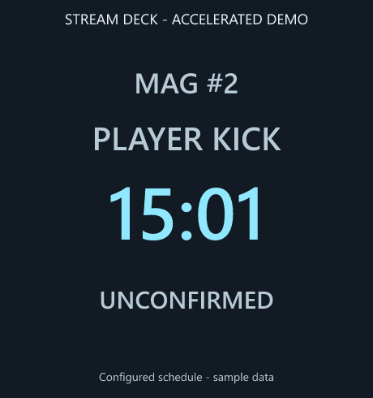

To regenerate on Windows, build `tests/MagDeer.ThemeTests` in Release, install the plugin's development dependencies and run `npm run preview:countdown` from `streamdeck`. Set `DOTNET_EXE` if the SDK is not in `.tools/dotnet`.

### Static examples

Normal, 15 minutes, 10 minutes, 5 minutes, 2:45 and 30 seconds. The last 30 seconds also have a small alternating opacity change on the digits; the rest of the window stays steady. A static PNG cannot show the pulse.

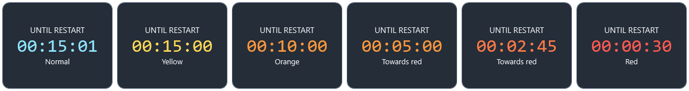

After a scheduled player kick, the negative timer stays orange without pulsing until the scheduled restart. RESTART WINDOW labels this schedule-based interval; Scheduled restart in shows how long remains until restart. At restart, the countdown moves to the next planned kick. This render uses demo data, not a confirmed kick event.

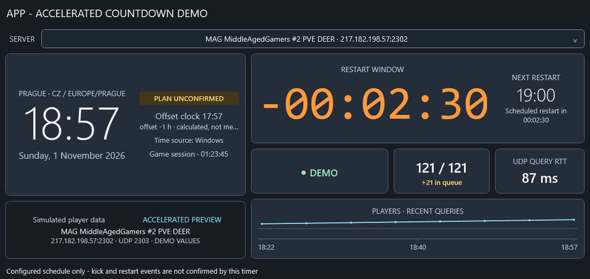

## Layouts

[Large wide window](images/layout-wide-large.png), [desktop](images/layout-desktop.png), [wide](images/layout-wide.png), [1280 x 400 strip](images/layout-bar-79.png), [1920 x 480 strip](images/layout-bar-88.png), [portrait](images/layout-portrait.png), [mini](images/layout-mini.png) and [ribbon](images/layout-ribbon.png).

[Settings](images/settings-overview.png), [restart controls](images/settings-restarts.png), [appearance](images/settings-appearance.png) and [Stream Deck key designs](images/stream-deck-keys.png).
