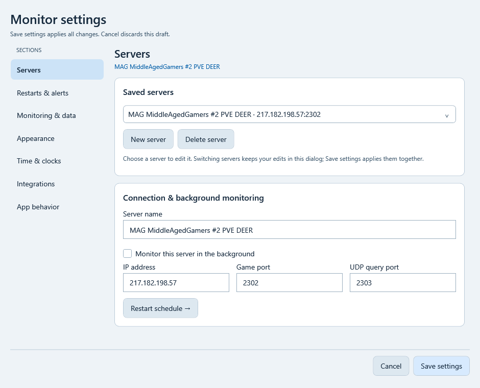
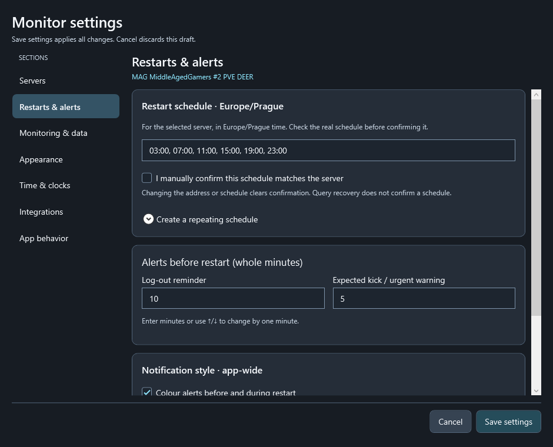
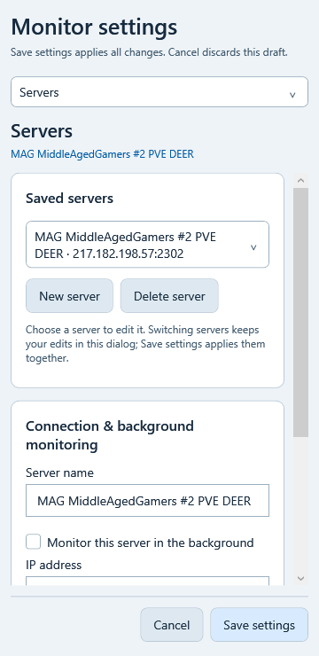

# Settings · 1.9.1

Settings use a section list on the left. In a window narrower than 680 logical pixels, a compact section selector replaces that list and form columns stack vertically. Each section scrolls independently; **Cancel** and **Save settings** remain at the bottom of the window.

| Section | What belongs here |
|---|---|
| Servers | Saved profiles, New/Delete, name, IP/game/query ports and background monitoring |
| Restarts & alerts | Selected server's Prague restart plan, confirmation, logout/kick reminders and notification style |
| Monitoring & data | Query intervals, timeout/failure rules, manual offline confirmation, local DayZ session and history storage |
| Appearance | Whole-window theme, language, display/size preset, compact mode and always on top |
| Time & clocks | 12/24-hour format, calculated offset clock, NTP and world-clock list/editor |
| Integrations | Stream Deck guidance, optional online-service checks and Grafana/Home Assistant export |
| App behavior | Close-to-tray/taskbar and startup with Windows |

The server name above Servers/Restarts identifies which profile is being edited. Restart times use **Europe/Prague**, independently of world clocks or the display format. The existing global polling/notification settings retain their scope; this reorganization does not give every server different polling intervals.

## One dialog, one final save

Choose a saved server to edit it. Moving between sections keeps the same controls and their contents. Switching to another server keeps valid changes in the dialog's draft, including a renamed profile. You can edit several profiles, then apply them together with **Save settings**. The old separate Edit/Save server buttons are no longer needed.

**New server** keeps the current valid profile draft before opening an empty new form. Leaving an untouched empty New form does not add a blank server. Invalid/incomplete profile values prevent switching profiles and show a validation message rather than silently losing the edit. **Delete server** still asks for confirmation and protects the last saved profile. It removes the entry from the draft, retaining historical data.

**Cancel** discards all profile/world-clock/global-setting drafts. Nothing is written to the real configuration until Save settings succeeds. The profile selected when saving becomes the desktop's selected server, as before.

## Keep optional details out of the way

The repeating restart generator, world-clock editor and latest service results are expandable. NTP connection details and HTTP export details are collapsed/disabled when their feature is off. Close destination is disabled until minimize-on-close is enabled. Disabled NTP/export settings keep their last saved connection values; an unfinished hidden edit cannot prevent turning the feature off.

Theme and language are the first card in Appearance. Selecting a world clock opens its editor. The date/time/source limits and service-check meanings are unchanged; see [clocks](LANGUAGES-AND-CLOCKS.md), [NTP](NTP.md) and [integrations](INTEGRATIONS.md).

These are renders of the actual WPF settings control with example values, without opening a desktop window or changing the running app. They are not photographs of physical LCDs. Geometry checks cover all seven sections in five languages, three palettes and 360/720/940-pixel logical widths. The real dialog on physical monitors still needs normal hands-on use.
