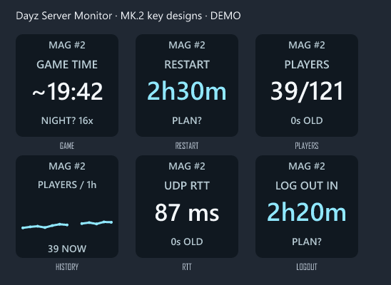

# Stream Deck MK.2

The plugin uses the official Elgato SDK and is designed for the MK.2's 72 × 72-pixel keys. It works alongside Dayz Server Monitor 1.7.0 or later on Windows 10/11 x64. Stream Deck software **7.1 or later**, including its Node.js 24 runtime, is required. Users do not need to install Node.js separately.

These are enlarged renders of the actual key images with demo values, not a photograph of a tested device.

## Installation

1. Download and unpack the Windows ZIP. Carry over your config.json and data folder if upgrading. Keep the executable in a stable, writable folder.
2. Start DayzServerMonitor.exe yourself when convenient and select the server to watch. The plugin never starts the monitor or brings its window forward. The monitor can be minimized.
3. Double-click **Dayz-Server-Monitor-1.7.0.streamDeckPlugin** and accept the installation in Stream Deck. The file is also inside the Windows ZIP.
4. Find **Dayz Server Monitor** in the Stream Deck action list. Drag **Cycle server information** onto a key.
5. Leave the action's default artwork/title in place. A custom image in Stream Deck can override the plugin's changing display.

No Marketplace account, API key, paid service, extra driver or administrator access is required for direct installation from this project. Do not run the Stream Deck app or monitor as administrator.

## One key or several

**Cycle server information** changes the view with a short press. Hold the key for one second to request a refresh. Releasing it after a hold does not also cycle the view. Choose the initial view and the views to include in the key's settings.

**Pinned server information** keeps one view on a key. A short press does not send a query. Hold for one second to refresh. Add several pinned keys to keep the game clock, restart countdown and players visible together.

All keys attached to the same monitor share its cached data and manual refresh guard. A hold cannot bypass a running query or the twenty-second limit, including across different keys and the desktop button. Automatic monitoring retains its configured cadence. Selecting another view does not send a game-server query.

| View | Display |
|---|---|
| Game time | Published game clock, optionally extrapolated as ~HH:mm; DAY? / NIGHT? and current assumed speed |
| Restart | Time until the next configured restart; PLAN? while the schedule is unconfirmed |
| Players | Players / capacity, published queue when nonzero, otherwise age of the query |
| History | One hour of player samples from the current monitor session, with gaps for missing replies |
| UDP RTT | Query round-trip time and age of the query |
| Logout | Time until the configured logout reminder, or LOG OUT NOW |

Restart warnings can temporarily override the selected view. This is enabled by default and can be disabled per key. Yellow uses the monitor's logout threshold; red uses its kick threshold. RESTART / NOW? is an expectation from the configured plan, not proof of a game restart.

The short server label is generated automatically, such as MAG #2, or can be replaced with up to twelve characters. Keys follow the server selected in the monitor; they do not each start a separate DayZ poller.

## Game time is a measurement plus an estimate

The monitor reads DayZ's published A2S keyword fields when present. A time such as 19:42 is the server's reported game clock at the last reply. The base multiplier is etm; entm is the additional night multiplier. For example, 4 × base and 4 × night gives an effective night speed of 16 × under standard DayZ settings.

Between replies, the plugin estimates the time using these multipliers. The ~ prefix marks extrapolation. DAY? / NIGHT? use assumed daytime hours, default **06:00–18:00 in game**, editable in the key settings. They are not observations of actual sunlight. Map, game date and custom server scripts can change sunrise, sunset or time behavior. No accurate astronomical day/night state is claimed.

If a multiplier is missing, the key retains the reported clock without extrapolation. If the server does not publish a game clock, it shows N/A. Failed/stale queries do not keep displaying old metrics as fresh. The optional offset clock in the desktop app remains a separate calculated clock.

Reference: [Bohemia's server configuration](https://community.bohemia.net/wiki/DayZ:Server_Configuration).

## Connection and missing data

The plugin reads one local snapshot per second per selected monitor, using a Windows named pipe restricted to the current user. There is no TCP/HTTP server in the monitor. Discovery files are stored under `%LOCALAPPDATA%\DayzServerMonitor\bridges`. No credentials are stored there.

Leave **Monitor data folder** blank to use the newest discovered running monitor. If several monitor instances use different data folders, enter the exact data folder to select one. Several keys with the same folder share one connection. A pinned view pins an information page, not the selected game server.

MONITOR OFF means the desktop monitor is unavailable or closed; the plugin does not launch it. QUERY / N/A means no usable query result is available. STALE means the last sample exceeded its expected cadence plus a grace period. A missing UDP reply does not prove the game is offline. WAIT 20s and QUERY RUNNING show the shared refresh restriction.

## Building and distribution

With .NET 8 SDK and Node.js 24+ installed, `./build.ps1` builds and tests both projects, validates the plugin with Elgato's official CLI, and creates the .streamDeckPlugin installer. `./build.ps1 -SkipStreamDeck` builds just the Windows monitor.

The Node tests include the actual bundled official-SDK plugin connected to a simulated Stream Deck host and a C# named-pipe fixture. They verify press/hold behavior, data transfer, cooldown across keys, and the MONITOR OFF state without opening the real desktop applications. Physical MK.2 installation, readability under its key lenses, sleep/reconnect and extended use still need hands-on testing.

The CLI may report that the project URL returns 404 because this GitHub repository is private. That warning does not make the installer public or submit it to Marketplace. No Marketplace submission or Maker Agreement acceptance is performed by this project.

Original code and the T/R icon are MIT-licensed. Elgato SDK and bundled runtime dependency licenses are preserved in the installer and docs/licenses/STREAMDECK-RUNTIME-NOTICES.md. Build tools are separate: the SVG renderer @resvg/resvg-js is MPL-2.0 and is used only during building/testing; its binary is not shipped in the plugin. See [names and trademarks](TRADEMARKS.md).
