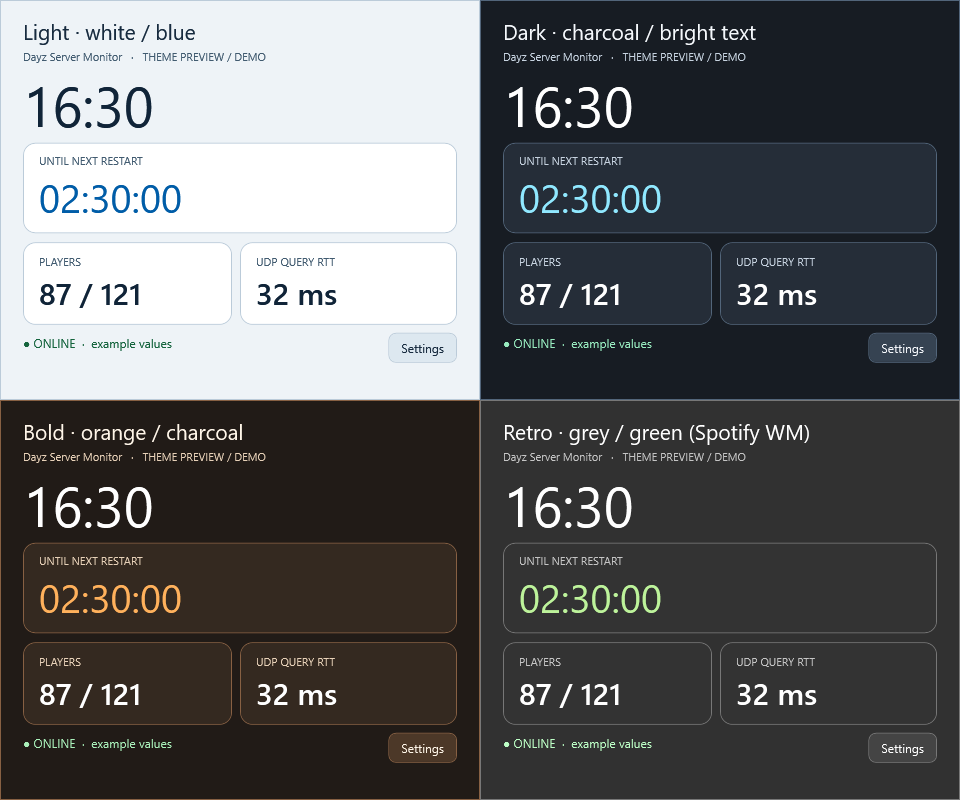

# Themes

Choose a theme at the top of **Settings → Appearance → Whole-window theme**. It changes the whole window, including cards, text, controls and graphs. The choice is saved in config.json.

| Theme | Background | Cards | Main numbers | Accent |
|---|---|---|---|---|
| Light | #EEF3F7 | #FFFFFF | #102438 | #005DA8 |
| Dark | #171C23 | #252D38 | #FFFFFF | #90E8FF |
| Orange | #211B17 | #342920 | #FFFFFF | #FFB15C |
| Gray/green retro | #313131 | #333333 | #FFFFFF | #BDF39B |

The last palette is stored under the legacy config key `Spotify`. It was inspired by color values in a historical Windows Mobile theme. No original art, branding, fonts or extracted resources are included.

Main player numbers have at least 7:1 contrast against their cards. The theme checks also verify normal text and status colors against the surfaces used by the application. Switching an existing card between themes is tested so its background and text stay in sync.

These examples are rendered from the actual WPF styles, with fixed demo values and no desktop window.
